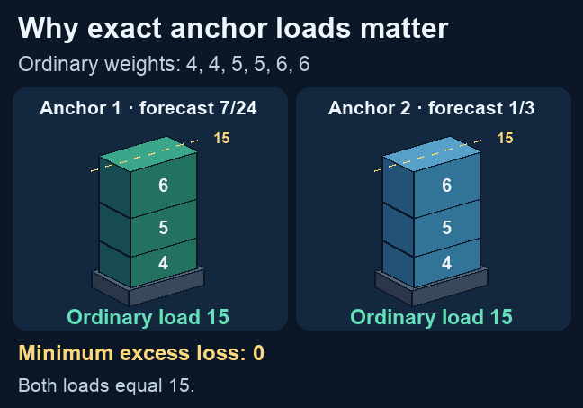

# No fully polynomial additive scheme for calibration distance unless P = NP

Approximating the **distance to the nearest exactly calibrated deterministic predictor** has no fully polynomial additive scheme unless P = NP. The obstruction holds with noiseless binary labels and nonuniform rational masses. If P = NP, a partition certificate and binary search give a scheme.

[Paper PDF](paper/manuscript.pdf) · [LaTeX source](paper/manuscript.tex) · [Catalog Q460](https://github.com/10m-u/open-problems-catalog/blob/ca8d4d44ba3db527f19f28928c240168f545ecfe/problems/computer_science_ai/classical-statistical-machine-learning.md#q460) · [Qiao’s open question](https://arxiv.org/html/2603.18391v2#S4)

## Why exact loads matter

Each heavy anchor pair wants to stay at its own forecast. With target load 15, weights 4, 5 and 6 fit in each anchored block and leave both anchor forecasts unchanged. With three 4s and three 6s, both loads are even. The closest assignment has loads 16 and 14 and incurs a strictly higher calibration cost.

[Download the offline explorer ZIP](https://raw.githubusercontent.com/DannyExperiments/calibration-distance-no-fptas/v1.0.0/visualization/calibration-distance-no-fptas-explorer.zip) · [Worked examples and rendering guide](visualization/README.md)

## Proof and earlier work

A low-cost partition keeps every anchor pair together and separate from the other pairs. The cost formulas turn any integer load deficit into an inverse-polynomial normalized gap on strongly hard 3-PARTITION instances.

Qiao’s exact algorithm for uniform masses and noiseless labels and the general additive PTAS remain applicable. The hard instances in this paper use indivisible weighted atoms. Fractional repairs and collections of separately assignable unit identities use different feasible sets. [Source and literature audit](audits/public_safe_reports/LITERATURE_AUDIT.md) · [Exact scope](CLAIM_SCOPE_AND_LIMITATIONS.md)

## Replay and citation

The [exact replay](REPRODUCIBILITY.md) enumerates every set partition in three ten-atom instances. It also checks both branches of the single-block loss formula. [Review status](STATUS.md) · [Research disclosure](AI_DISCLOSURE.md)

DannyExperiments is the preferred citation identity. [Release v1.0.0](https://github.com/DannyExperiments/calibration-distance-no-fptas/releases/tag/v1.0.0) · [Version DOI](https://doi.org/10.5281/zenodo.24571158) · [Citation metadata](CITATION.cff)

## Lean verification

Lean checks the underloaded-anchor inequality, the overloaded-anchor identity, exact balance of integer deficits and excesses including outside mass, and the two-thirds additive gap given the aggregate loss bound and a positive deficit. The statement uses rational anchor data. The structural reduction to intact anchor pairs, the hardness source and the polynomial encoding are proved in the paper. [Lean source and replay](formalization/README.md)
